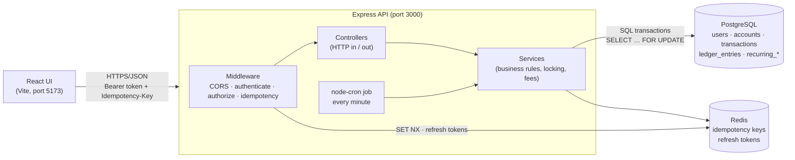
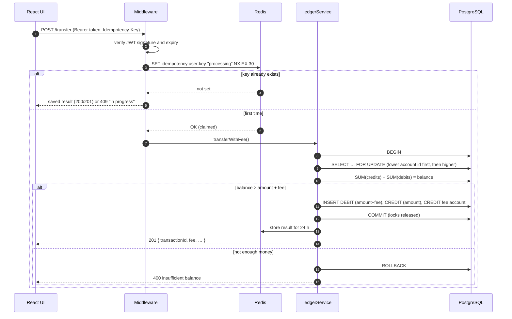
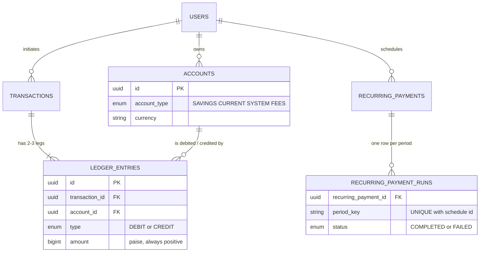

# ◆ LedgerVault

**A concurrency-safe, double-entry banking ledger** built with Node.js, Express, PostgreSQL and Redis, with a React front end that makes the money movement visible.

> Money moves between accounts as matching **debit and credit entries** in an append-only ledger. Transfers are **safe under heavy concurrency** (row locks, deadlock-free ordering), **safe to retry** (Redis idempotency keys), and **safe to access** (short-lived JWTs with revocable refresh tokens and role-based access control).

---

## Contents
1. [Why this project exists](#why-this-project-exists)
2. [Features](#features)
3. [The screens](#the-screens)
4. [Architecture](#architecture)
5. [Tech stack](#tech-stack)
6. [Project structure](#project-structure)
7. [Getting started](#getting-started)
8. [API reference](#api-reference)
9. [Testing](#testing)
10. [Key design decisions](#key-design-decisions)
11. [Known limitations and roadmap](#known-limitations-and-roadmap)
12. [Further reading](#further-reading)

---

## Why this project exists

Moving money is the classic place where "it works on my machine" software breaks. Three things go wrong in the real world:

| Problem | What it looks like | LedgerVault's answer |
|---|---|---|
| **Race conditions** | 20 payments hit an account at the same instant; every one of them reads "balance OK" before any has spent it, and the account goes negative (a *double spend*). | Pessimistic row locks (`SELECT … FOR UPDATE`) inside a database transaction. |
| **Duplicate requests** | A user double-clicks "Pay", or a phone retries after a network blip, and the money moves twice. | An `Idempotency-Key` header, claimed atomically in Redis. |
| **Unauthorised access** | A stolen token, or a normal user calling admin endpoints. | 15-minute access tokens, revocable refresh tokens, role checks on routes *and* inside the services. |

The project is a deliberately small but honest model of how a real bank core handles these, with tests that **prove** each guarantee rather than just claiming it.

---

## Features

**For customers**
- Register / log in; open savings and current accounts
- Add money (simulated cash-in, written as real ledger entries)
- Send money by recipient email, with a **live fee preview** and a review screen showing the exact ledger rows
- Statement per account with a **running balance**; click any row to see the full double-entry transaction
- **Recurring payments** (daily / weekly / monthly) that can never pay the same period twice

**For the bank (admin)**
- "Books are balanced ✓" integrity report (total debits = total credits; all balances sum to zero)
- Bank-wide transaction explorer with every debit/credit leg
- Fees collected

**Learning / demo**
- **Race-condition demo**: fire N simultaneous payments at an account *without* locking (it overspends) and *with* locking (it is exact), side by side

**Engineering guarantees**
- Append-only ledger; balances are always *calculated*, never stored
- Money is stored as **integer paise** (no floating-point errors)
- Deadlock-free by construction (accounts are locked in sorted-ID order)
- Per-user idempotency keys; rotating, revocable refresh tokens
- Method-level ownership checks in addition to route-level roles

---

## The screens

| Screen | What it demonstrates |
|---|---|
| Login / Register | JWT access token + Redis-backed refresh token |
| Dashboard | Balances computed from the ledger; idempotent "add money" and "open account" |
| Send money | Fee engine, recipient lookup, review step showing the 3 ledger rows |
| Statement | Running balance (SQL window function), double-entry legs per transaction |
| Recurring | Scheduler, run history, exactly-once payment per period |
| Race demo | The bug LedgerVault exists to prevent, shown live |
| Admin | Books-balanced proof, bank-wide activity, role-based access |

*(Add screenshots to `docs/screenshots/` and link them here before publishing.)*

---

## Architecture



**Layers (each has exactly one job)**

| Layer | Folder | Job |
|---|---|---|
| Routes | `src/routes` | Map URL + method to a controller, and attach middleware in the right order |
| Middleware | `src/middleware` | Cross-cutting checks: auth, roles, idempotency, CORS |
| Controllers | `src/controllers` | Read the HTTP request, call a service, shape the HTTP response and status code |
| Services | `src/services` | **All business rules**: locking, balance checks, fees, recurring logic |
| Models | `src/models` | Table definitions and relationships (Sequelize) |

### What happens when you press "Send"



### Data model



There is **no balance column anywhere**. `balance = SUM(credits) − SUM(debits)` for an account. The `ledger_entries` table is insert-only.

---

## Tech stack

| Area | Technology | Used for |
|---|---|---|
| Runtime | **Node.js 20+** | Server and scripts |
| Web framework | **Express 4** | HTTP routing and middleware |
| Database | **PostgreSQL** | Source of truth; ACID transactions; row locks |
| ORM | **Sequelize 6** | Models, transactions, `FOR UPDATE` / `SKIP LOCKED` |
| Cache / state | **Redis** (via `ioredis`) | Idempotency keys, refresh tokens |
| Auth | **jsonwebtoken**, **bcrypt** | Access/refresh tokens, password hashing |
| Scheduling | **node-cron** | Recurring-payment job |
| Front end | **React 19**, **Vite 5**, **React Router 7** | The UI (plain CSS, no UI library) |

---

## Project structure

```
banking-core/                  ← backend (API)
├── src/
│   ├── server.js              start-up: connect DB, sync tables, create bank accounts, start cron
│   ├── app.js                 Express app: CORS, JSON, routes
│   ├── config/                database.js, redis.js
│   ├── models/                User, Account, Transaction, LedgerEntry, RecurringPayment(+Run)
│   ├── services/              ledgerService (core), feeService, authService, bankService,
│   │                          accountService, adminService, recurringService, demoService
│   ├── controllers/           thin HTTP handlers
│   ├── routes/                auth, ledger, recurring, demo
│   ├── middleware/            auth (authenticate/authorize), idempotency, cors
│   ├── jobs/                  recurringPaymentJob (cron)
│   └── utils/                 jwt, money, validate, httpErrors
├── scripts/                   tests and utilities (see Testing)
└── docs/                      DEADLOCK_TEST.md, FAILURE_PATH_TESTS.md

ledgervault-ui/                ← front end
└── src/
    ├── api.js                 fetch wrapper: tokens, single-flight refresh, idempotency keys
    ├── auth.jsx               login state for the whole app
    ├── money.js               "500.50" → 50050 paise without floats
    ├── components/            Layout, Explain, Legs, AccountCard, SessionPanel
    └── pages/                 Login, Dashboard, Send, Statement, Recurring, RaceDemo, Admin
```

---

## Getting started

### Prerequisites
- Node.js **20 or newer**
- PostgreSQL 14+ (running locally)
- Redis (easiest with Docker)

### 1. Database
```sql
CREATE DATABASE banking_core;
```

### 2. Redis
```bash
docker run -d --name banking-redis -p 6380:6379 redis:7
```
(This maps Redis to host port **6380**; use `REDIS_PORT=6380` below. Any port works as long as `.env` matches.)

### 3. Backend
```bash
cd banking-core
npm install
cp .env.example .env        # then edit the values
npm run dev
```

`.env` variables:

| Variable | Example | Meaning |
|---|---|---|
| `PORT` | `3000` | API port |
| `DB_HOST` `DB_PORT` `DB_NAME` `DB_USER` `DB_PASSWORD` | `localhost` `5432` `banking_core` `postgres` `…` | Postgres connection |
| `REDIS_HOST` `REDIS_PORT` | `localhost` `6380` | Redis connection |
| `JWT_ACCESS_SECRET` | long random string | Signs access tokens |
| `JWT_REFRESH_SECRET` | a *different* long random string | Signs refresh tokens |
| `JWT_ACCESS_EXPIRY` | `15m` | Access-token lifetime |
| `JWT_REFRESH_EXPIRY` | `7d` | Refresh-token lifetime |
| `CORS_ORIGINS` *(optional)* | `http://localhost:5173` | Allowed browser origins |

On first start the server creates the tables and the bank's own **fee account** and **cash reserve account** automatically. You should see:
```
Postgres connection established.
Models synced.
Bank system accounts ready.
Recurring payment job scheduled (every minute).
Server running on port 3000
```

### 4. Front end
```bash
cd ledgervault-ui
npm install
npm run dev                 # http://localhost:5173
```
`ledgervault-ui/.env` (optional) sets `VITE_API_URL=http://localhost:3000`.

### 5. Try it
1. Register two users (Alice, Bob) and open a savings account for each.
2. As Alice: **Add money**, then **Send money** to Bob's email.
3. Open **Statement** and click the transfer to see its three ledger rows.
4. Open **Race demo** and click *Run both*.

### 6. Become an admin (to see the Admin page)
Admins are never created through the public API. Promote a user from the backend folder:
```bash
node scripts/makeAdmin.js you@example.com
```
Then **log out and log in again** (the role is stored in your token at login).

---

## API reference

All money endpoints expect `Authorization: Bearer <access token>`. Endpoints marked **idem** also require an `Idempotency-Key` header (any unique string, e.g. a UUID).

| Method | Path | Auth | Description |
|---|---|---|---|
| GET | `/health` | none | Liveness check |
| POST | `/api/auth/register` | none | Create a USER (role in the body is ignored) |
| POST | `/api/auth/login` | none | Returns `{ user, accessToken, refreshToken }` |
| POST | `/api/auth/refresh` | refresh token in body | New token pair; the old refresh token is revoked |
| POST | `/api/auth/logout` | refresh token in body | Revokes that refresh token |
| GET | `/api/auth/me` | user | Current profile |
| GET | `/api/ledger/accounts` | user | My accounts with balances |
| POST | `/api/ledger/accounts` | user, **idem** | Open an account (`SAVINGS` / `CURRENT`, max 5) |
| POST | `/api/ledger/accounts/:id/deposit` | owner, **idem** | Simulated cash-in (max ₹1,00,000) |
| GET | `/api/ledger/accounts/:id/balance` | owner / admin | Balance in paise |
| GET | `/api/ledger/accounts/:id/transactions` | owner / admin | Statement with legs and running balance (`limit`, `offset`) |
| GET | `/api/ledger/directory?email=` | user | Find a recipient's accounts |
| GET | `/api/ledger/fee-quote?amountPaise=` | user | Fee preview |
| POST | `/api/ledger/transfer` | owner, **idem** | Move money (amount + fee) |
| POST | `/api/recurring` | owner, **idem** | Create a schedule |
| GET | `/api/recurring` | user | My schedules |
| GET | `/api/recurring/:id/runs` | owner / admin | Payment history |
| DELETE | `/api/recurring/:id` | owner / admin | Cancel a schedule |
| POST | `/api/demo/race` | user | Race demo (`mode: "safe" \| "unsafe"`) on sandbox accounts |
| GET | `/api/ledger/admin/integrity` | **ADMIN** | Books-balanced report |
| GET | `/api/ledger/admin/transactions` | **ADMIN** | Bank-wide transactions with legs |
| GET | `/api/ledger/admin/fees-balance` | **ADMIN** | Fees collected |
| POST | `/api/recurring/admin/run-due` | **ADMIN** | Run due payments now |

**Status codes:** `400` invalid input or insufficient funds · `401` missing/invalid/expired token · `403` not allowed · `404` not found · `409` duplicate request still in progress · `201` created.

**Money format:** every amount is an **integer number of paise** (₹1 = 100). `amountPaise: 50000` means ₹500.00. Decimals and strings are rejected.

---

## Testing

The tests are scripts, not a framework. Each one prints PASS / FAIL lines and exits non-zero on failure.

| Script | Needs server? | Proves |
|---|---|---|
| `node scripts/concurrencyTest.js` | no | 20 simultaneous transfers out of an account funded for 10: exactly 10 succeed, balance exactly 0 |
| `node scripts/deadlockTest.js` | no | 200 simultaneous A↔B transfers: 0 deadlocks and exact balances (a naive version deadlocks) |
| `node scripts/recurringDemo.js` | no | Recurring payments pay exactly once even with 5 concurrent job runs and replays |
| `node scripts/apiSmokeTest.js` | **yes** | Every feature end to end over HTTP (36 checks) |
| `node scripts/failurePathTests.js` | **yes** | 48 attack/misuse checks: forged tokens, role escalation, other users' accounts, bad amounts, duplicate requests |

Detailed write-ups: [Deadlock test](banking-core/docs/DEADLOCK_TEST.md) · [Failure-path tests](banking-core/docs/FAILURE_PATH_TESTS.md).

---

## Key design decisions

| Decision | Why | Alternative not chosen |
|---|---|---|
| Append-only ledger, **no balance column** | Auditable; no "balance drifted" bugs; the sum *is* the truth | A mutable `balance` column (fast to read, easy to corrupt) |
| **Integer paise** in a `BIGINT` | Exact arithmetic | `FLOAT` / `DECIMAL`-as-number (rounding errors) |
| **Pessimistic locking** (`FOR UPDATE`) | Money should wait, not fail and retry; simple to reason about | Optimistic locking (retry storms on hot accounts) |
| **Sorted lock order** | Makes deadlock impossible | Detect-and-retry |
| **Redis** idempotency (`SET NX`) | Atomic, fast, built-in expiry | DB unique key (stronger, slower; see limitations) |
| Short **JWT** + **revocable** refresh in Redis | Fast stateless checks *and* instant logout | Server sessions only (every request hits the store); long-lived JWTs (can't be revoked) |
| Recurring runs recorded with a **unique (schedule, period)** | Exactly-once even if the job fires twice or crashes | In-memory "already ran" flags |
| Routes check **roles**, services check **ownership** | Defence in depth: a new route can't forget the ownership check | Route-level checks only |
| Redlock **dropped** | Single Postgres instance; the DB's own locks are the right tool | Distributed lock across Redis nodes (unjustified complexity) |

See [INTERVIEW.md](INTERVIEW.md) for the reasoning behind each one.

---

## Known limitations and roadmap

Being honest about the edges is part of the design:

- **Balance = SUM of entries.** Perfect for correctness, but it slows as an account's history grows. Next step: periodic balance snapshots (a checkpoint row) and sum only newer entries.
- **Idempotency lives in Redis.** If the server crashes *after* the database commit but *before* the result is stored, a retry after the 30-second claim expires could repeat the payment. The stronger design stores the key in the same database transaction (unique constraint).
- **Single instance.** The cron job runs inside the API process. It is safe with several instances (row locks with `SKIP LOCKED` + unique run rows) but a dedicated worker/queue would be cleaner.
- **Tokens in `localStorage`.** Fine for a demo; production would prefer `httpOnly` cookies.
- **No rate limiting or account lockout** yet (brute-force protection).
- **Schema via `sequelize.sync()`**, not migrations.
- **Simulated deposits;** there is no real payment gateway.
- Tests are scripts, not a CI-integrated framework.

---

## Further reading
- [Deadlock test](banking-core/docs/DEADLOCK_TEST.md)
- [Failure-path tests](banking-core/docs/FAILURE_PATH_TESTS.md)